<!-- Anshul Sharma · github.com/AnshulSharma9340 · concept: a training run that is still going -->

<picture>
  <source media="(prefers-color-scheme: dark)" srcset="assets/banner-dark.svg">
  <source media="(prefers-color-scheme: light)" srcset="assets/banner-light.svg">
  
</picture>

  <picture>
    <source media="(prefers-color-scheme: dark)" srcset="https://readme-typing-svg.demolab.com?font=JetBrains+Mono&weight=500&size=15&duration=2800&pause=800&color=22D3EE&center=true&vCenter=true&width=900&height=34&lines=fine-tunes+and+distils+3B+LLMs+with+4-bit+QLoRA;real-time+speech+enhancement+at+~250x+realtime;agent+harnesses%3A+orchestration%2C+tools%2C+MCP+servers%2C+eval+passes;AI+for+construction%3A+scope-of-work+review+with+proof+per+finding;B.Tech+CSE+%28Data+Science%29%2C+ITM+Gwalior%2C+2023-2027">
    
  </picture>

  &nbsp;
  &nbsp;
  &nbsp;
  

I build machine-learning systems end to end: fine-tuning and distilling small LLMs with 4-bit QLoRA, real-time speech models written from scratch, and the orchestration, tooling and evaluation layer that makes LLM agents dependable. Right now that is AI engineering at **Rapid Innovation** — AI for construction, plus harness engineering: the reliability layer around agents (orchestration, tools, MCP servers, QA/eval passes). I am also still a B.Tech CSE (Data Science) student at ITM Gwalior, class of 2027 — which is why the run above is not finished.

 

## eval/ &nbsp;projects, with the numbers I actually measured

Latency and throughput figures below were measured on my own machine — an RTX 2050 laptop GPU. No cloud cluster was harmed.

| run | what it does | measured · shipped |
|:--|:--|:--|
| **[cue-interview-copilot](https://github.com/AnshulSharma9340/cue-interview-copilot)** | Free, open-source real-time AI interview & meeting copilot (Electron). Local `faster-whisper large-v3-turbo` with streaming partials, a primed pool of Claude processes, mock interviews, meeting auto-detect, a question bank and BM25 document search. | Transcript **0.5 s** after a question ends · first answer words **~3 s** after · MIT |
| **[lyra-audio-model](https://github.com/AnshulSharma9340/lyra-audio-model)** | Lyra-Audio: from-scratch real-time speech enhancement — VAD + acoustic echo cancellation + noise suppression in a single pass. DeepFilterNet-style: ERB STFT → causal U-Net + GRU → complex deep filter. Trained on LibriSpeech + ESC-50. | **~20 ms** per pass · **~250× realtime** · **+2.76 dB** SI-SDR · Apache-2.0 |
| **[ReasonMind-3B](https://github.com/AnshulSharma9340/ReasonMind-3B)** | Distils DeepSeek-R1-style chain-of-thought into Llama-3.1 3B with Unsloth + 4-bit QLoRA, with an explicit `<think>` phase. Shipped as GGUF for offline inference. | **~0.5 %** of parameters trained · 4-bit QLoRA · GGUF **Q8_0** |
| **[Subcontractor-sow-agent](https://github.com/AnshulSharma9340/Subcontractor-sow-agent)** | SOW Agent — Construction Scope Intelligence. Reviews a construction Scope of Work against the drawing set for one trade: Claude vision take-off per sheet, then every finding ships with its proof — verbatim quotes, sheet/page, highlighted crop. | **7** specialist agents in parallel + an independent **QA pass** that rejects unproven findings |
| **[Custom-nano](https://github.com/AnshulSharma9340/Custom-nano)** | Training a custom ~3B LLM end to end on Karpathy's nanochat pipeline — tokenizer → pretraining → SFT — with my own SFT data. | **~3B** parameters · full pipeline, not a fine-tune |
| **[MedSafeNet](https://github.com/AnshulSharma9340/MedSafeNet)** | DistilBERT medical-safety guardrail classifier, served with FastAPI and streaming responses. | **5** classes: `SAFE` · `MEDICAL` · `DANGEROUS` · `SELF_HARM` · `MISINFORMATION` |

<b>more runs</b> &nbsp;research engines, products, classic ML, and the DSA grind

 

| run | what it is |
|:--|:--|
| [luminal-ai-research-engine](https://github.com/AnshulSharma9340/luminal-ai-research-engine) · [NEXUS-AI](https://github.com/AnshulSharma9340/NEXUS-AI) | Perplexity-style research engines: live search via SerpAPI → page extraction → Gemini synthesis with citations |
| [Slate](https://github.com/AnshulSharma9340/Slate) | Local-first notes + infinite whiteboard + links · Electron, React, SQLite |
| [Discipline-X](https://github.com/AnshulSharma9340/Discipline-X) | Accountability platform · FastAPI, Supabase, React, Socket.IO |
| [Employee-Insight-Engine](https://github.com/AnshulSharma9340/Employee-Insight-Engine) | Four ML models for attrition and performance — the Cognify internship project |
| [PneumoScan-AI](https://github.com/AnshulSharma9340/PneumoScan-AI) | Pneumonia detection from chest X-rays |
| [Online-suspicious-transaction-detection-](https://github.com/AnshulSharma9340/Online-suspicious-transaction-detection-) | Anomaly detection on online transactions |
| [WebGenius](https://github.com/AnshulSharma9340/WebGenius) | AI website builder: prompt in, responsive site out |
| [Jarvis-Ai-](https://github.com/AnshulSharma9340/Jarvis-Ai-) | Voice assistant |
| [Face-Based-Attendance-Attribute-System](https://github.com/AnshulSharma9340/Face-Based-Attendance-Attribute-System) | Face-based attendance system |
| [LeetCode / NeetCode](https://github.com/AnshulSharma9340?tab=repositories&language=c%2B%2B) | C++ submissions — the DSA practice that never shows up in a demo |

 

## checkpoints/ &nbsp;where the run has been

| ckpt | where | what |
|:--|:--|:--|
| **now** | **Rapid Innovation** — AI engineering | AI for construction; harness engineering around LLM agents: orchestration, tools, MCP servers, QA/eval passes |
| 03 | **Veridia.io** — Data Analytics Intern | Resume Intelligence System: ML candidate scoring and categorisation |
| 02 | **Cognify Technologies** — Machine Learning Intern · Aug–Oct 2025 | Employee Insight Engine: four ML models for attrition and performance prediction |
| 01 | **Prodigy Infotech** — Data Science Intern | Suspicious-transaction detection built on anomaly-detection models |
| 00 | **ITM Gwalior** — B.Tech CSE (Data Science) · 2023–2027 | Where the run started |

 

## forward pass &nbsp;the stack a request travels through

<picture>
  <source media="(prefers-color-scheme: dark)" srcset="assets/stack-dark.svg">
  <source media="(prefers-color-scheme: light)" srcset="assets/stack-light.svg">
  
</picture>

 

## metrics/ &nbsp;live from GitHub, not typed in

<table align="center" border="0">
<tr>
<td width="50%" valign="top">
<picture>
  <source media="(prefers-color-scheme: dark)" srcset="https://github-readme-stats-salesp07.vercel.app/api?username=AnshulSharma9340&show_icons=true&hide_border=true&bg_color=00000000&title_color=22D3EE&text_color=C9D3E3&icon_color=A78BFA&ring_color=22D3EE&include_all_commits=true&count_private=true">
  <source media="(prefers-color-scheme: light)" srcset="https://github-readme-stats-salesp07.vercel.app/api?username=AnshulSharma9340&show_icons=true&hide_border=true&bg_color=00000000&title_color=0891B2&text_color=2F3741&icon_color=7C3AED&ring_color=0891B2&include_all_commits=true&count_private=true">
  
</picture>
</td>
<td width="50%" valign="top">
<picture>
  <source media="(prefers-color-scheme: dark)" srcset="https://streak-stats.demolab.com?user=AnshulSharma9340&hide_border=true&background=00000000&ring=22D3EE&fire=FBBF24&currStreakNum=E6EDF3&currStreakLabel=22D3EE&sideNums=E6EDF3&sideLabels=8B96A8&dates=8B96A8&stroke=1E293B">
  <source media="(prefers-color-scheme: light)" srcset="https://streak-stats.demolab.com?user=AnshulSharma9340&hide_border=true&background=00000000&ring=0891B2&fire=D97706&currStreakNum=1F2328&currStreakLabel=0891B2&sideNums=1F2328&sideLabels=636C76&dates=636C76&stroke=D0D7DE">
  
</picture>
</td>
</tr>
<tr>
<td colspan="2" align="center">
<picture>
  <source media="(prefers-color-scheme: dark)" srcset="https://github-readme-stats-salesp07.vercel.app/api/top-langs?username=AnshulSharma9340&layout=compact&hide_border=true&bg_color=00000000&title_color=22D3EE&text_color=C9D3E3&langs_count=8&card_width=500">
  <source media="(prefers-color-scheme: light)" srcset="https://github-readme-stats-salesp07.vercel.app/api/top-langs?username=AnshulSharma9340&layout=compact&hide_border=true&bg_color=00000000&title_color=0891B2&text_color=2F3741&langs_count=8&card_width=500">
  
</picture>
</td>
</tr>
</table>

 

## logs/ &nbsp;every commit the snake has eaten

<picture>
  <source media="(prefers-color-scheme: dark)" srcset="https://raw.githubusercontent.com/AnshulSharma9340/AnshulSharma9340/output/github-snake-dark.svg">
  <source media="(prefers-color-scheme: light)" srcset="https://raw.githubusercontent.com/AnshulSharma9340/AnshulSharma9340/output/github-snake.svg">
  
</picture>

 

## external evals &nbsp;certifications

<b>8 passed</b> &nbsp;cloud, deep learning, data science

 

| eval | issuer |
|:--|:--|
| Oracle Cloud Infrastructure & Data Science Professional | Oracle |
| Microsoft Azure Developer Associate | Microsoft |
| Google Cloud Data Analytics | Google Cloud |
| Deep Learning | NPTEL · IIT Ropar |
| Google AI/ML Internship | Eduskills · AICTE |
| Python Full Stack Developer | Eduskills · AICTE |
| Cisco Data Science | Cisco |
| Alteryx Data Analytics Internship | Alteryx |

 

## endpoint &nbsp;reach me

**[LinkedIn](https://www.linkedin.com/in/anshulaiml/)** for work · **[anshulsharma7162@gmail.com](mailto:anshulsharma7162@gmail.com)** for everything else · **[portfolio](https://portfolio-sandy-five-8ulr675iy1.vercel.app/)** for the longer version.

If you are building something where the model is the easy part and the system around it is the hard part, I would like to hear about it.

Footnote: the loss curve at the top is the only made-up number on this page. Everything else is measured, linked, or pulled live.

<picture>
  <source media="(prefers-color-scheme: dark)" srcset="assets/footer-dark.svg">
  <source media="(prefers-color-scheme: light)" srcset="assets/footer-light.svg">
  
</picture>
