<div align="center">



<a href="https://github.com/AnshulSharma9340">
  
</a>

<br/>

<a href="https://www.linkedin.com/in/anshulaiml/"></a>
<a href="https://portfolio-sandy-five-8ulr675iy1.vercel.app/"></a>
<a href="mailto:anshulsharma7162@gmail.com"></a>


</div>

---

## ⚡ `whoami`

```python
from dataclasses import dataclass

@dataclass(frozen=True)
class AnshulSharma:
    role      = "AI/ML Engineer @ Rapid Innovation"
    focus     = ("Construction AI", "Agent harness engineering", "Real-time voice AI")
    building  = [
        "multi-agent systems that review construction scopes against drawing sets",
        "agent harnesses: tool use, MCP servers, sandboxing, evals, retries",
        "streaming speech → LLM pipelines that answer in ~3 seconds",
    ]
    trains    = ["QLoRA / Unsloth fine-tunes", "reasoning distillation", "small LLMs end to end"]
    education = "B.Tech CSE (Data Science) · ITM Gwalior · 2023–2027"
    motto     = "Ship it. Measure it. Make it 10x faster."
```

---

## 🏗️ What I'm building now

<table>
<tr>
<td width="33%" valign="top">

### 🏗️ Construction AI
Agents that read a **Scope of Work** and a full **drawing set**, do a visual take-off of every sheet, and cross-check the two in both directions. Each finding carries its proof: the exact quote, the sheet, and a highlighted crop.

</td>
<td width="33%" valign="top">

### 🧩 Harness Engineering
The layer that makes LLMs **reliable**: orchestration of parallel specialist agents, independent QA passes that reject unproven claims, sealed tool sandboxes, MCP servers, streaming, retries and evals.

</td>
<td width="33%" valign="top">

### 🎙️ Real-time Voice AI
Streaming speech recognition on a consumer GPU, then a **primed LLM pool** for first words in ~2 s. Also from-scratch speech enhancement (VAD + echo cancellation + denoising) in a 20 ms pass.

</td>
</tr>
</table>

---

## 🚀 Featured work

<table>
<tr>
<td width="50%" valign="top">

### 🎙️ [Cue — Real-time Interview Copilot](https://github.com/AnshulSharma9340/cue-interview-copilot)
Listens to a call, transcribes both sides with **local Whisper on the GPU**, detects questions and streams an answer **~3 s** after the question ends. No API keys needed.<br/>
   

</td>
<td width="50%" valign="top">

### 🏗️ [SOW Agent — Construction Scope Intelligence](https://github.com/AnshulSharma9340/Subcontractor-sow-agent)
Reviews a trade's **Scope of Work against the drawing set**: Claude vision take-off per sheet, **7 specialist agents** in parallel, and an independent QA pass. Every finding shows its proof.<br/>
   

</td>
</tr>
<tr>
<td width="50%" valign="top">

### 🧠 [ReasonMind-3B — Reasoning Distillation](https://github.com/AnshulSharma9340/ReasonMind-3B)
Distils **DeepSeek-R1-style chain-of-thought** into Llama-3.1 3B with **Unsloth + 4-bit QLoRA**, training about 0.5% of the parameters, with a `<think>` phase. Shipped as **GGUF** for offline inference.<br/>
   

</td>
<td width="50%" valign="top">

### 🔊 [Lyra-Audio — Real-time Speech Enhancement](https://github.com/AnshulSharma9340/lyra-audio-model)
A from-scratch **VAD + echo cancellation + noise suppression** model in one ~20 ms pass (DeepFilterNet-style U-Net + GRU). **~250× real time** on an RTX 2050, +2.76 dB SI-SDR.<br/>
  

</td>
</tr>
<tr>
<td width="50%" valign="top">

### 🛡️ [MedSafeNet — Medical AI Guardrail](https://github.com/AnshulSharma9340/MedSafeNet)
A **DistilBERT safety classifier** (safe / medical / dangerous / self-harm / misinformation) that filters queries in real time before generation, served over **FastAPI** with streaming.<br/>
 

</td>
<td width="50%" valign="top">

### 🔬 [Custom-Nano — 3B LLM, end to end](https://github.com/AnshulSharma9340/Custom-nano)
Training a custom **3B-parameter LLM** with Karpathy's *nanochat* pipeline, from tokenizer through pretraining to SFT, with my own SFT data mixes.<br/>
  

</td>
</tr>
</table>

<details>
<summary><b>➕ More projects</b></summary>
<br/>

| Project | What it is |
|---|---|
| [Luminal](https://github.com/AnshulSharma9340/luminal-ai-research-engine) · [NEXUS-AI](https://github.com/AnshulSharma9340/NEXUS-AI) | Perplexity-style research engines: live search, extraction, Gemini synthesis with citations |
| [Slate](https://github.com/AnshulSharma9340/Slate) | Local-first notes + infinite whiteboard + links (Electron, React, SQLite) |
| [Employee Insight Engine](https://github.com/AnshulSharma9340/Employee-Insight-Engine) | 4 ML models for attrition and performance prediction |
| [PneumoScan AI](https://github.com/AnshulSharma9340/PneumoScan-AI) | Pneumonia detection from chest X-rays |
| [Suspicious Transaction Detection](https://github.com/AnshulSharma9340/Online-suspicious-transaction-detection-) | Real-time anomaly detection with a Streamlit UI |
| [DisciplineX](https://github.com/AnshulSharma9340/Discipline-X) | Accountability platform: FastAPI, Supabase, React, Socket.IO |

</details>

---

## 💼 Experience

| | Role | Highlights |
|:---:|---|---|
| 🟢 **Now** | **AI/ML Engineer · Rapid Innovation** | Construction-intelligence agents · agent harness engineering · production LLM integrations |
| 2025 | **Data Analytics Intern · Veridia.io** | Built a **Resume Intelligence System**: ML candidate scoring and categorization |
| 2025 | **Machine Learning Intern · Cognify Technologies** | **Employee Insight Engine**: 4 models for attrition and performance prediction |
| Earlier | **Data Science Intern · Prodigy Infotech** | Live **suspicious transaction detection** using anomaly detection |

---

## 🧰 Arsenal

<div align="center">

**🤖 LLMs & Agents**<br/>


**🧪 Training & Models**<br/>


**🛠️ Engineering**<br/>


</div>

---

## 📊 GitHub in numbers

<div align="center">


<picture>
  <source media="(prefers-color-scheme: dark)" srcset="https://raw.githubusercontent.com/AnshulSharma9340/AnshulSharma9340/output/github-snake-dark.svg"/>
  <source media="(prefers-color-scheme: light)" srcset="https://raw.githubusercontent.com/AnshulSharma9340/AnshulSharma9340/output/github-snake.svg"/>
  
</picture>

</div>

---

## 🏅 Certifications

<details>
<summary><b>View 10+ verified credentials</b></summary>
<br/>

| ☁️ Cloud | Issuer |
|---|---|
| Oracle Cloud Infrastructure & Data Science Professional | Oracle |
| Azure Developer Associate | Microsoft |
| Google Cloud Data Analytics | Google Cloud |

| 🧠 AI / ML & Development | Issuer |
|---|---|
| Deep Learning | NPTEL · IIT Ropar |
| Google AI/ML Internship | Eduskills · AICTE |
| Python Full Stack Developer | Eduskills · AICTE |
| Data Science | Cisco |
| Data Analytics Internship | Alteryx |

</details>

---

<div align="center">

### 🤝 Let's build something intelligent

Open to collaborations on **agents**, **LLM infrastructure** and **voice AI**.

<a href="https://www.linkedin.com/in/anshulaiml/"></a>
<a href="mailto:anshulsharma7162@gmail.com"></a>


</div>
